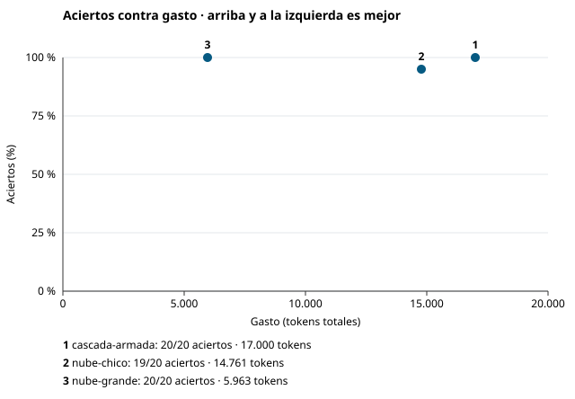

# Lab 1 · Decisión

## 1. Tabla de resultados
(pegar aquí el contenido de resultados/resumen.md)

## 2. Gráfico

## 3. Casos importantes
- Reclamo R__:
- Reclamo R__:

## 4. Regla de ruteo de modelos
| Tarea | Modelo o configuración | Por qué se elige | Riesgo y privacidad | Cuándo escalar |
|---|---|---|---|---|
| | | | | |

## 5. Lo que el chequeo no verifica